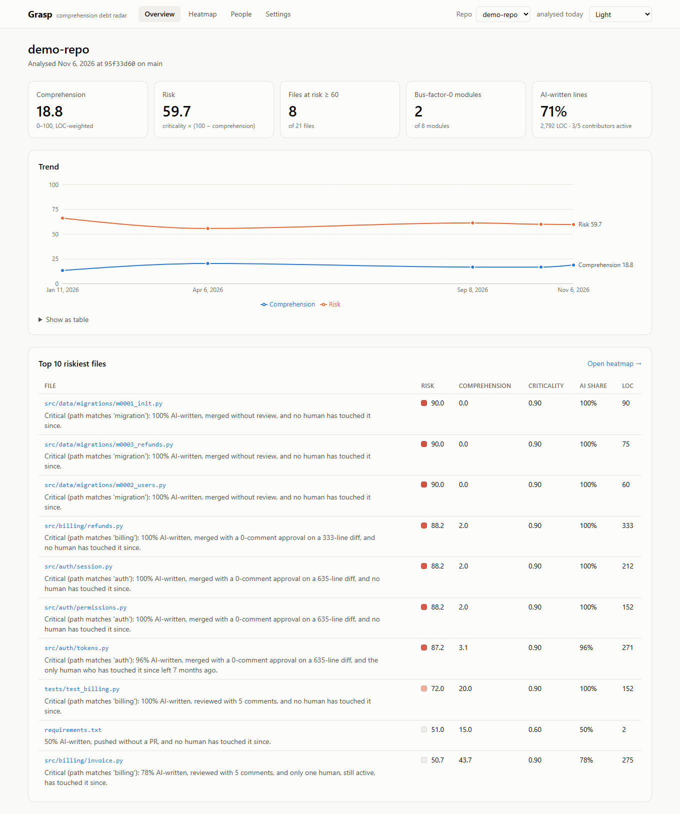
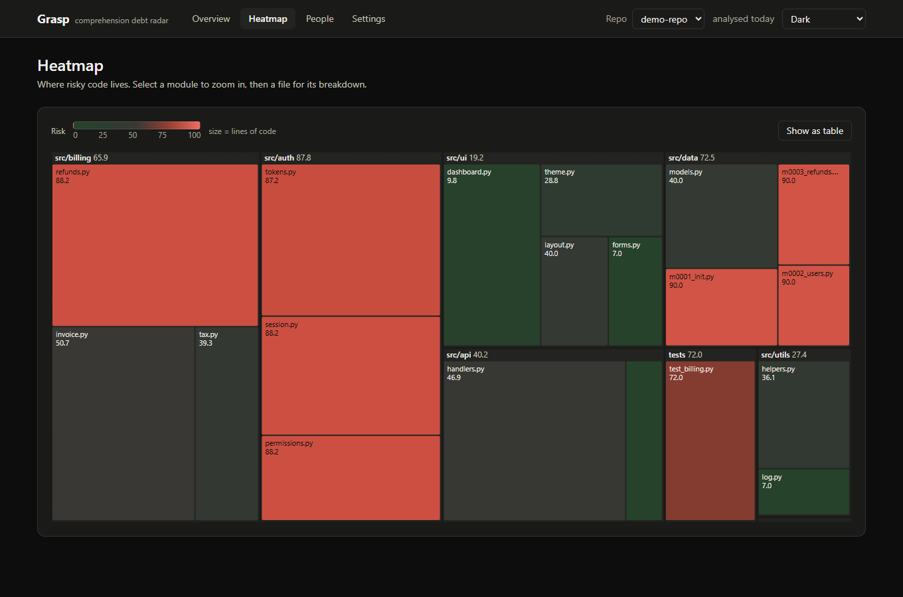
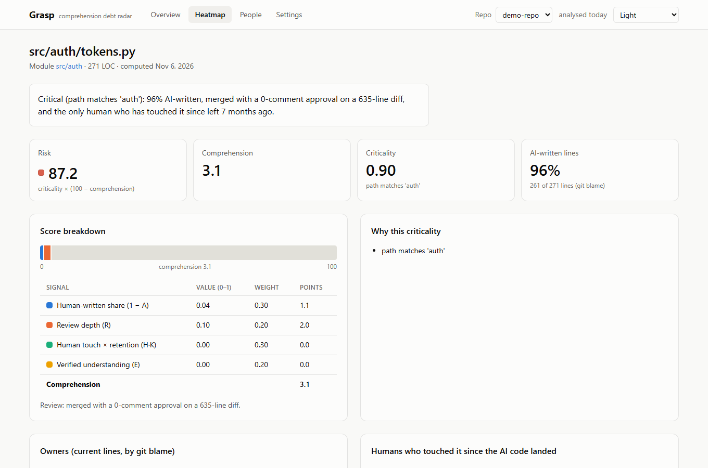
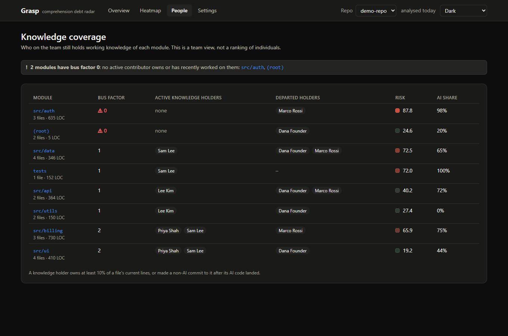

# Grasp: a comprehension debt radar

**Comprehension debt** is the gap between how much code a repo contains and how much of it the team actually understands. It grows fastest when AI agents (Claude Code, Copilot, Cursor, Codex…) write code that gets merged with little review and is never touched by a human again.

Grasp measures **team understanding of code, not code quality**. It answers three questions:

1. Where is the code that nobody on the team really understands?
2. How risky is that, given how critical the code is?
3. Who should learn which module, and which PRs need extra scrutiny?

> **Principle: no individual performance scoring.** Grasp never ranks engineers by comprehension or AI usage. People-level data is only used to show *knowledge coverage per module* (for example "bus factor 0").

## Status

| Phase | Scope | Status |
|---|---|---|
| 1 | Local CLI ingestion: git log + blame, AI detection, AI line share | ✅ done |
| 2 | Signals (review, human touch, retention), scoring, criticality, snapshots | ✅ done |
| 3 | Dashboard (overview, heatmap, file detail, people, settings) | ✅ done |
| 4 | GitHub App + PR comprehension check | ⏳ |
| 5 | Walkthroughs + quizzes (opt-in LLM) | ⏳ |

## Quickstart

### Demo in one command

```bash
make demo        # or, without make:  npm install && npm run demo
```

This builds a synthetic repo in `repos/demo`. It contains human-written code, AI-written code merged with rubber-stamp reviews, a contributor who has left, and a dependency bot. The script analyses the repo at five points in its history, writes the result to `data/demo.json`, and serves the dashboard at **http://localhost:4000**.

### Analyse your own repo

```bash
pip install -e "worker[dev]"
npm install && npm run build
python worker/cli.py analyze /path/to/repo --since 365d --json data/myrepo.json
node apps/api/dist/index.js          # serves every *.json in data/ on http://localhost:4000
```

Re-running against the same `--json` file is **incremental**: only new commits are read, and only files changed since `lastAnalyzedSha` are re-blamed. Pass `--full` to force a complete re-run. Settings you save in the dashboard go to `data/myrepo.json.settings.json`, and the worker applies them on its next run.

### Docker (Mongo mode)

```bash
docker compose up -d mongo redis api web                  # dashboard on http://localhost:5173
docker compose run --rm worker analyze /repos/<name>      # repos are mounted from ./repos (GRASP_REPOS_DIR)
```

### Development

```bash
npm run dev:api     # API on :4000, serves data/
npm run dev:web     # Vite dev server on :5173, proxies /api
```

## Dashboard

| | |
|---|---|
|  |  |
|  |  |

- **Overview**: repo comprehension and risk, a trend line built from snapshots, and the top 10 riskiest files, each with a one-sentence explanation.
- **Heatmap**: a treemap where size is LOC and colour is risk. Low risk is pale green, the middle is neutral gray and high risk is deep red. Lightness also changes with risk, so the scale stays readable with red-green colour blindness. Select a module to zoom in, then a file to open its detail page. Everything works by keyboard (Tab, then Enter), and a table view is available.
- **File detail**: the score broken down into its A / R / H·K / E points, owners and whether they're active, the humans who have touched the file since the AI code landed, AI evidence per commit, and the reasons behind its criticality.
- **People**: knowledge coverage per module and the bus-factor-0 list. *No individual scores or rankings.*
- **Settings**: weights, AI regexes, critical paths and the LLM opt-in, validated with Zod.

Light and dark themes are both supported. With 5,000 files, the overview and the heatmap each load in under 600 ms (measured by the Playwright suite).

## How AI-assisted lines are detected

Each line's current owner comes from `git blame --line-porcelain` at `HEAD`. A line counts as AI-assisted if its commit has **any** of the following (each match is stored as an evidence string):

- a `Co-Authored-By:` trailer naming Claude, Copilot, Cursor, Codex, Devin, Gemini or aider
- a message matching `Generated with`, 🤖, or any of your own regexes
- a bot author (`[bot]`, `noreply@anthropic.com`, configurable)
- a PR label such as `ai-generated` (needs GitHub mode)

`A = aiLines / totalLines` per file.

## Scoring

Each signal is a number from 0 to 1 per file. Every value is stored on the `FileScore` together with its evidence, so any number in the UI can be traced back to where it came from.

| Signal | Meaning |
|---|---|
| **A** AI line share | `aiLines / totalLines` from `git blame` (see above) |
| **R** review depth | Blame-weighted over the PRs that introduced the current lines. Unreviewed = 0. A 0-comment approval on a diff over 200 lines = 0.1 ("rubber-stamp"). Otherwise `0.5·substantive + 0.5·min(1, (minutes / max(1, lines/50)) / 10)`. In local mode with no PR data, R = 0.5 and the UI says *review data unavailable*. You can supply PR data with `--pr-data prs.json`. |
| **H** human touch | Distinct humans who made non-AI commits to the file after its AI lines landed. Each is weighted `0.5^(age/120d)`, and `H = 1 − e^(−Σw)`. |
| **K** retention | The share of H's weight that comes from contributors who are still active (committed in the last 90 days) |
| **E** verified | 1.0 for 180 days after a passed learning task that someone else verified, then falls linearly to 0 by day 365. This is 0 until Phase 5. |

```
comprehension = 100 · clamp(0.30·(1−A) + 0.20·R + 0.30·(H·K) + 0.20·E, 0, 1)   (weights configurable)
risk          = criticality · (100 − comprehension)
criticality   = max(floor 0.1,
                    0.9 if the path matches auth|login|session|payment|billing|crypto|migration|schema|permission|token,
                    1.0 if the path is listed in criticalPaths,
                    0.8 × import fan-in percentile (JS/TS + Python),
                    0.6 × 90-day churn percentile,
                    optional LLM verdict)
```

Files roll up into modules (LOC-weighted means). Every run writes a `Snapshot` used for trend charts.

### Optional LLM criticality (two opt-ins required)

Set `"llmCriticality": true` in `.grasp.json` **and** `GRASP_ALLOW_LLM_CODE=true`. Each request sends only the file path, the first 60 lines and the exported symbol names. Verdicts are cached by content hash, and every call is written to `llmAudit` with the file, the bytes sent and the model. Supported providers:

- `anthropic`: Claude, via the optional `anthropic` package
- `gemini`: Google AI Studio, which has a free tier
- `openai`: any OpenAI-compatible endpoint, including Groq and OpenRouter (both have free tiers) and **local Ollama**, which is free and keeps your code on your machine

See `.env.example` for setup.

## Configuration

Put a `.grasp.json` file in the repo root, or pass `--config`. Every key is optional:

```json
{
  "aiTrailerPatterns": ["^Co-Authored-By:.*(Claude|Copilot|Cursor|Codex|Devin|Gemini|aider)"],
  "aiMessagePatterns": ["Generated with", "🤖"],
  "botPatterns": ["\\[bot\\]"],
  "aiPrLabels": ["ai-generated"],
  "ignoreGlobs": ["node_modules/", "*.min.js", "docs/**"],
  "moduleRoots": ["src"],
  "activeDays": 90,
  "weights": {"wA": 0.3, "wR": 0.2, "wH": 0.3, "wE": 0.2},
  "criticalPaths": ["src/ledger/"],
  "criticalPathPatterns": ["auth|login|session|payment|billing|crypto|migration|schema|permission|token"],
  "importAliases": {"@/": "src/"},
  "llmCriticality": false
}
```

Vendored, generated and binary files are skipped: the default ignore globs, binary files, and anything marked `linguist-generated` or `linguist-vendored` in `.gitattributes`.

## Privacy

By default **no source code leaves your machine**. LLM features are opt-in per repo, send the minimum context needed, and every call is logged to an audit collection (Phase 2+).

## Testing

```bash
make test     # worker pytest (fixture repos) + API Vitest
make e2e      # Playwright: smoke tests + 5k-file load check (uses Edge on Windows;
              #             elsewhere run `npx playwright install chromium` once)
make lint     # ruff + mypy + ESLint + Prettier + tsc
cd worker && python -m pytest -m slow -s   # 50k-LOC worker performance test
```

## Roadmap

- **Phase 4**: a GitHub App that backfills PR and review data (so R is real) and adds a "Grasp: comprehension check" on PRs that touch high-risk files
- **Phase 5**: walkthroughs and quizzes (opt-in LLM) that feed the verified-understanding signal E
